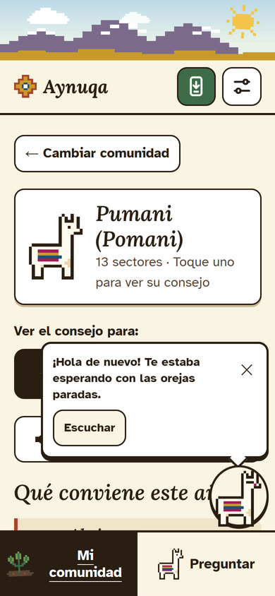
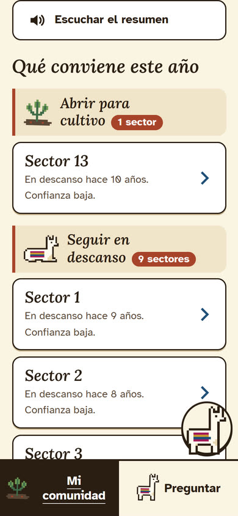
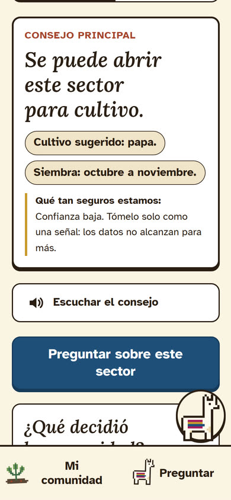
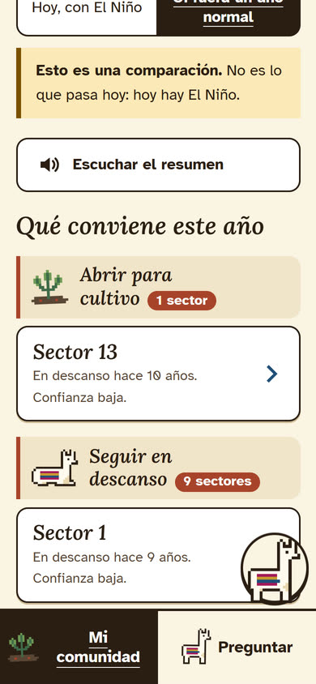
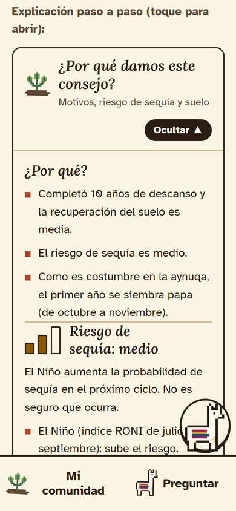
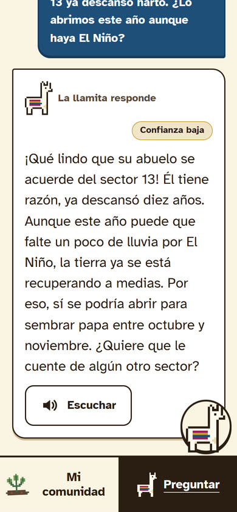
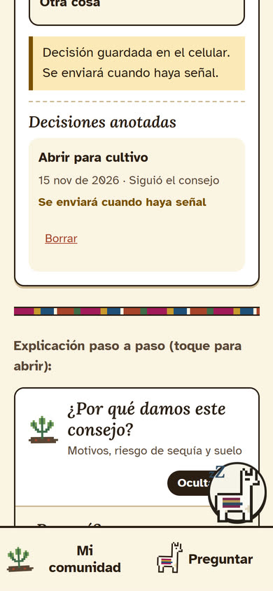
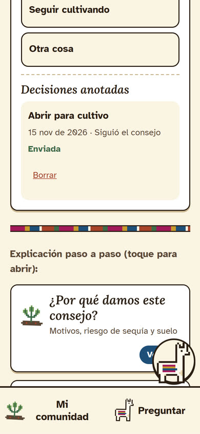
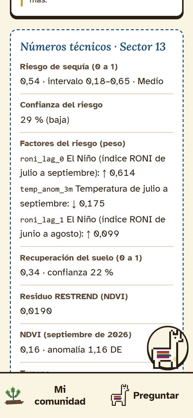
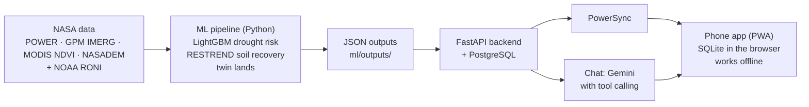

# Aynuqa Field Shift

**The ancient and the new, deciding together.**

A phone app that helps Andean communities plan their communal field rotation (the *aynuqa*) under El Niño and climate change, using NASA data.

Built by **Manada Prime** for the NASA Space Apps Challenge 2026, challenge *Field Shift: Adapting Farms with NASA Data*.

## Demo video

[](https://youtu.be/_nsD0_TYTzk)

Click the image to watch the demo on YouTube: https://youtu.be/_nsD0_TYTzk

## The problem

In the Bolivian highlands (Altiplano), communities have rotated their land for centuries with the **aynuqa**. The land is split into fields. Some are planted for a few years while others rest, sometimes for up to ten years, so the soil can recover. Every year the community decides which field to open.

That decision has always been based on experience. Climate change is making that experience less reliable. And El Niño is active right now: NOAA's Relative Oceanic Niño Index (RONI) was **+1.97** for August to October 2026, which raises the chance of drought in the Altiplano. It does not make drought certain, and the app says so.

On top of that, many communities have poor mobile signal and few phones.

## What the app does

For each field of the community, the app estimates:

1. **Drought risk** for the coming season.
2. **Soil recovery** during the rest period.

It turns them into simple advice: **which field to open, how many more years to rest the others, what to plant and when.** Every piece of advice shows **how confident we are**, and today that confidence is low.

| | | |
|:-:|:-:|:-:|
|  |  |  |
| **Opens straight into the community.** No sign-up. | **This year's advice**, grouped by what to do. | **One field:** open for planting, potato, October to November, low confidence. |
|  |  |  |
| **El Niño today vs. a normal year**, one tap apart. | **Why this advice**, in plain words. | **Ask the llama** in plain language (Gemini with tool calling). |
|  |  |  |
| **No signal?** The decision is saved on the phone. | **Signal back:** the decision is sent on its own. | **Advanced mode** shows every number behind the advice. |

The app is in Spanish, which is what communities use day to day. It also has Aymara and Quechua translations and voice; native speakers still need to review them.

### Main features

- **Advice for every field**, with its confidence level.
- **El Niño today vs. a normal year.** The El Niño scenario is the real current state; the normal year is the comparison.
- **Twin lands:** for each field, the most similar field in another Altiplano zone, and how its vegetation (NDVI) actually changed during El Niño 2015–16 or 2023–24.
- **Chat with the llama.** Ask questions in plain language. The chat uses Google Gemini with **tool calling**: every number in an answer comes from our data through a tool (`get_sector`, `compare_scenarios`, `get_history`, `get_sensors`, `get_twin_precedent`), so the model does not make figures up. Without signal, it answers from the data saved on the phone.
- **Works offline.** The app is installable (PWA). Data is synced to the phone and stays available without signal. Decisions recorded offline are sent when the signal returns.
- **Community decisions.** The community records what it decided, even if it chose something different from the advice.
- **Built for low-end phones:** large text, few screens, compressed responses for poor connections, and a printable summary for meetings.

## How it works



1. **Data pipeline (`ml/`).** Downloads monthly data for Pumani and 7 similar Altiplano zones: **8 zones and 26 growing seasons since 2000**.
2. **Drought risk.** A LightGBM model. It is trained **without latitude or longitude**, so it learns from physical conditions and can be applied to similar communities. SHAP shows the main drivers of each prediction.
3. **Soil recovery.** RESTREND: greenness (NDVI) corrected for rainfall.
4. **Backend (`backend/`).** FastAPI loads the ML outputs and serves them. It does not compute predictions itself.
5. **App (`frontend/`).** React PWA. PowerSync copies the data from PostgreSQL to SQLite on the phone, so it keeps working without signal.

### Scale matters

All fields of one community fall inside the same NASA POWER cell (about 50 km). So **rain, temperature and soil moisture are the same for every field of a community.** What sets one field apart from another is its **greenness (MODIS NDVI, 250 m)** and its **terrain (NASADEM, 30 m)**. The app never shows climate differences between fields.

## Data

| Source | What it gives us | Resolution |
| --- | --- | --- |
| **NASA POWER** (daily, AG community) | Temperature, root-zone soil moisture, solar radiation | 0.5° (about 50 km) |
| **GPM IMERG V07** (NASA GES DISC) | Rainfall, monthly and daily | 0.1° (about 10 km) |
| **MODIS NDVI** MOD13Q1 / MYD13Q1 (via NASA AppEEARS) | Greenness of each field | 250 m |
| **NASADEM** (via NASA AppEEARS) | Elevation, slope, aspect | 30 m |
| **NOAA RONI** | El Niño index (official since February 2026) | Global |
| CHIRPS v2.0 | Fills gaps in rainfall | 0.05° |
| SENAMHI Bolivia, Ayo Ayo station | Checks satellite rain and temperature (not used for training) | Point |

Climate history runs from 2000 to today.

## Validation (reported as obtained)

We tested the model on data it had not seen:

| Test | Our model | Simple baselines | Result |
| --- | --- | --- | --- |
| New **zones** (leave one zone out) | RMSE 0.56 | 0.73 | Better than the baselines |
| New **seasons** (leave one season out) | RMSE 0.88 | 0.74–0.78 | Not better yet |

On the Pumani backtest, the season-level correlation goes the opposite way from what we expected. That is why **every piece of advice shows its confidence**, and why the app supports the community's decision instead of replacing it.

## What is real and what is simulated

- **Real:** climate, rainfall, soil moisture, vegetation (NDVI), terrain and the El Niño index.
- **Simulated:** the field boundaries, the years each field has rested, and the field sensors. Simulated data carries `is_simulated: true` and is labeled in the app.

Case study: Pumani (Pomani), Aroma Province, La Paz, Bolivia, at about 3,900 m.

## Run it locally

You need **Docker Desktop** and **Node.js 20+**.

```bash
# 1. Configuration
cp .env.example .env                  # Docker Compose settings
cp backend/.env.example backend/.env  # add LLM_API_KEY and LLM_MODEL for the chat

# 2. Backend, PostgreSQL and PowerSync
docker compose up --build -d

# 3. App
cd frontend
cp .env.example .env                  # set VITE_DATA_MODE=api to use the backend
npm install
npm run dev
```

Open the URL that Vite prints. Check that the backend is running at http://localhost:8000/health.

- **Chat:** it needs `LLM_API_KEY` and `LLM_MODEL` (a Gemini Flash model). `docker-compose.yml` does not pass them to the backend container yet, so add them to the `backend` service's environment (or an `env_file`).
- **Offline mode:** set `VITE_POWERSYNC_ENABLED=true`. Details and an offline test are in [docs/OFFLINE_POWERSYNC.md](docs/OFFLINE_POWERSYNC.md).
- **On a real phone:** see "Verla en el celular con el backend" in [frontend/README.md](frontend/README.md) for a one-tunnel setup with ngrok.
- **Secrets** go only in `.env` files, never in the repo.

## Repository structure

```
contracts/   Shared data contract: JSON schemas, endpoints and mock examples
ml/          Data download, features, models, validation and JSON outputs
backend/     FastAPI API, PostgreSQL, offline snapshots and PowerSync auth
frontend/    Installable phone app (React PWA)
powersync/   Self-hosted PowerSync service and sync rules
docs/        Pitch, scripts, slides (docs/pitch/) and screenshots
```

Each folder has its own README. Team rules for working on the repo are in `CLAUDE.md`.

## Credits

- NASA POWER, GPM IMERG (GES DISC), MODIS and NASADEM (LP DAAC, through AppEEARS).
- NOAA Climate Prediction Center (RONI), CHIRPS (UCSB Climate Hazards Center), SENAMHI Bolivia.
- Satellite basemap: Esri, Maxar, Earthstar Geographics and the GIS User Community.
- Aymara and Quechua voice: Meta MMS-TTS (`facebook/mms-tts-ayr`, `facebook/mms-tts-quh`), CC-BY-NC 4.0.
- Google Gemini API; WebLLM (MLC) with Qwen2.5-0.5B-Instruct as an optional on-device model.
- Fonts: Atkinson Hyperlegible and Lora (SIL Open Font License).
- The motion graphics in the demo videos were generated with AI assistance.
